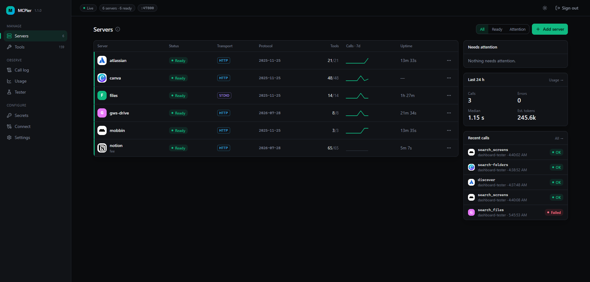
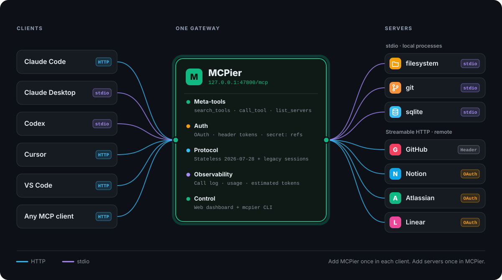
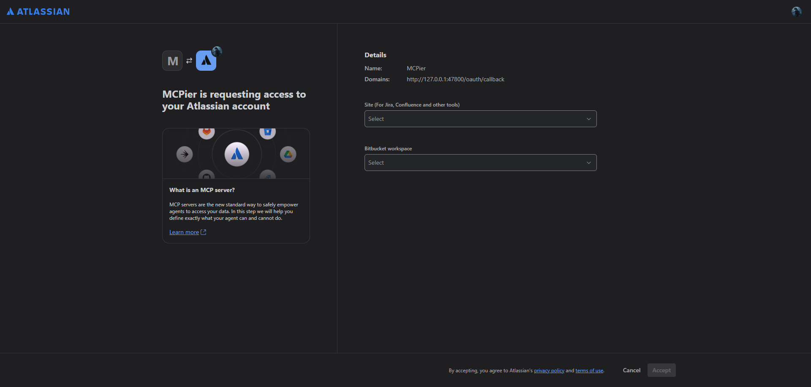
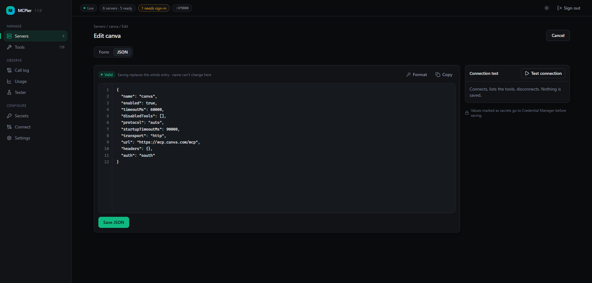
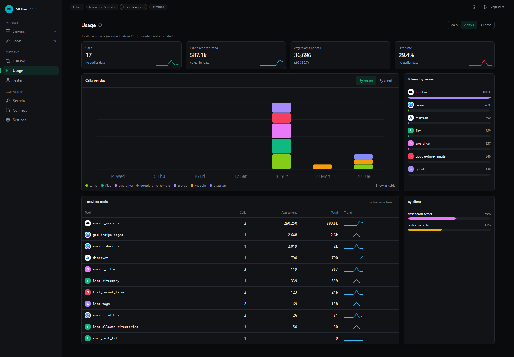
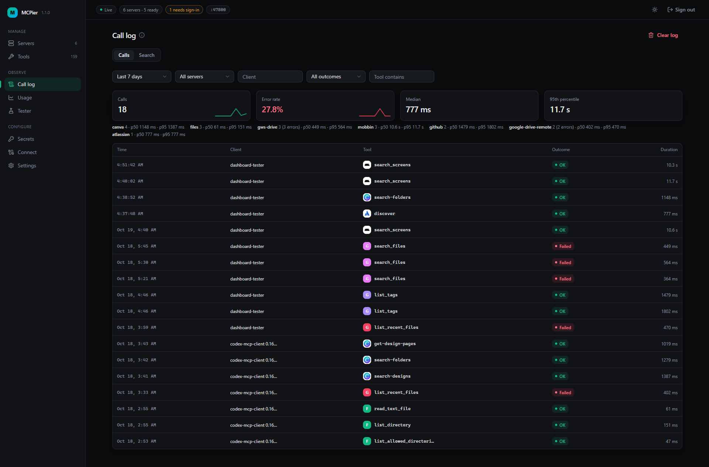
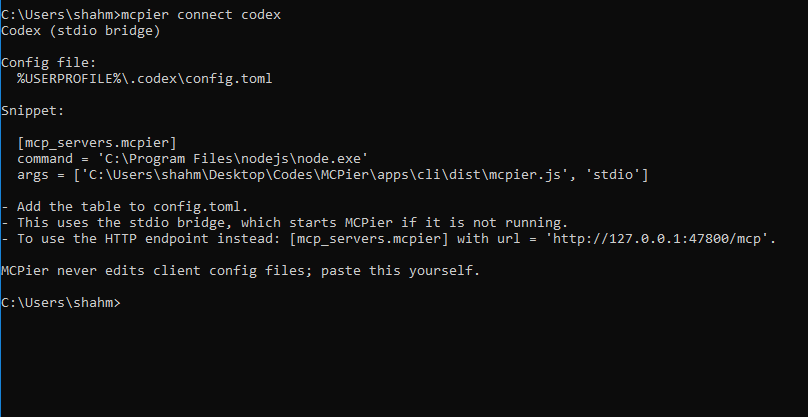

<div align="center">

# MCPier

**One local MCP gateway for all your clients and all your servers.**

Add your MCP servers once. Point every client at MCPier. Done.

[](#install)
[](#requirements)
[](https://nodejs.org/)
[](https://modelcontextprotocol.io/)
[](LICENSE)

[Features](#features) · [Install](#install) · [Quick start](#quick-start) · [Connect your clients](#connect-your-clients) · [Commands](#commands) · [Security](#security)



</div>

## Why MCPier

Every MCP client wants its own copy of your servers. Claude Code, Codex, Cursor, VS Code and Claude Desktop each have their own config file, their own secrets and their own sign-ins, so one new server means five edits and five places to leak a token.

MCPier sits in the middle. Your clients connect to **one** local endpoint, MCPier runs every server behind it, and you manage all of it from a single dashboard or CLI.

<p align="center">
  <picture>
    <source media="(prefers-color-scheme: dark)" srcset="assets/architecture-dark.svg">
    <source media="(prefers-color-scheme: light)" srcset="assets/architecture-light.svg">
    
  </picture>
</p>

## Features

###  Unified Endpoint

Clients add MCPier once, at `http://127.0.0.1:47800/mcp` or through the stdio bridge. Add, remove or reconfigure servers in MCPier and every client sees the change. No client config file is ever touched again.

###  Supports stdio and Streamable HTTP servers

- **Local stdio servers:** paste the command (`npx`, `uvx`, an `.exe`, anything). MCPier starts them hidden, watches them and restarts them when they crash.
- **Remote Streamable HTTP servers:** paste the URL. MCPier connects with the stateless `2026-07-28` protocol or falls back to legacy sessions automatically.

### 🔐 OAuth and header-based auth

- **OAuth:** MCPier handles the whole sign-in: discovery, dynamic client registration or your own client ID, the browser flow, scopes, step-up and automatic token refresh. Tested with Notion, Atlassian and Canva.
- **Headers and environment variables:** `Authorization: Bearer secret:github-token`. The `secret:` reference is resolved from Windows Credential Manager at run time, so the value never sits in a config file.

<p align="center"></p>

###  Built for the stateless MCP spec

MCPier speaks the [`2026-07-28` MCP specification](https://blog.modelcontextprotocol.io/posts/2026-07-28/), where requests are stateless and no session handshake is needed. Older clients and servers on `2025-11-25` sessions keep working: MCPier serves both on the same endpoint and negotiates per server (`--protocol auto | modern | legacy`).

###  Small context, any number of servers

Clients don't load hundreds of tool definitions up front. MCPier exposes three meta-tools:

| Meta-tool      | What it does                                         |
| -------------- | ---------------------------------------------------- |
| `list_servers` | What is connected and whether it's ready             |
| `search_tools` | Finds the right tools by what they do, across all servers |
| `call_tool`    | Runs a tool on the server that owns it               |

Only the tools the model searches for reach its context, whether you run 3 servers or 30.

###  Dashboard and CLI

Everything works both ways. The **web dashboard** has servers with their real logos and live status, a tool catalog with per-tool toggles, a tool tester, a JSON editor for server entries, a secrets page and copy-paste client setup. The **`mcpier` CLI** does the same from a terminal, and is scriptable with `--json`.

<p align="center"></p>

###  Works with all the clients

Claude Code, Claude Desktop, Codex, Cursor and VS Code have ready-made setup snippets, and any other MCP client works through the HTTP URL or the stdio command. See [Connect your clients](#connect-your-clients).

###  Usage tracking and tool-call logging

- **Call log:** every tool call and search, with arguments, result, duration, outcome and the client that made it. Errors are shown as a clean message, with the raw response one click away. Secrets are redacted before anything is stored.
- **Usage:** calls over time, estimated tokens returned, the heaviest tools, and usage by server and by client, over 24 hours, 7 days or 30 days.
- **Activity per server:** that server's calls and its own output, live.

<p align="center"></p>
<p align="center"></p>

### 📥 Import your existing config

Already have servers in Claude Desktop or VS Code? `mcpier server import` reads any `mcpServers` (or VS Code `servers`) block. Credential-looking values and OAuth client secrets move into Credential Manager on the way in.

## Requirements

- Windows 10 or later
- [Node.js 24](https://nodejs.org/)
- [pnpm](https://pnpm.io/)

## Install

<<<<<<< HEAD
=======
From the repository root (Git Bash, PowerShell, or Command Prompt):

>>>>>>> 0526224f404b82afd30bd0d19f1be0e9887f0d69
```bash
git clone https://github.com/Mrunal-Shah7/mcpier.git
cd mcpier
pnpm install
pnpm build
cd apps/cli
pnpm add -g .
mcpier --version
```

<<<<<<< HEAD
The last command prints `1.1.0`. If `mcpier` is not found, run `pnpm setup` once and open a new terminal so pnpm's global bin directory is on your `PATH`.

Commands work in Git Bash, PowerShell and Command Prompt.
=======
The last command prints `1.1.0`. If `mcpier` is not found, run `pnpm setup` once and open a new terminal so the global bin directory is on your `PATH`.
>>>>>>> 0526224f404b82afd30bd0d19f1be0e9887f0d69

## Quick start

```bash
# 1. Start the gateway
mcpier start

# 2. Add a local stdio server
mcpier server add files -- npx -y @modelcontextprotocol/server-filesystem "C:\Users\me\Documents"

# 3. Add a remote server with a header token
mcpier secret set github-token
mcpier server add github --url https://api.githubcopilot.com/mcp/ --header "Authorization: Bearer secret:github-token"

# 4. Add a remote server with OAuth, then sign in
mcpier server add notion --url https://mcp.notion.com/mcp --oauth
mcpier auth login notion

# 5. Open the dashboard
mcpier open
```

Then connect a client, for example `mcpier connect claude-code`.

To bring servers over from an existing client:

```bash
mcpier server import "$APPDATA/Claude/claude_desktop_config.json" --dry-run
mcpier server import "$APPDATA/Claude/claude_desktop_config.json"
```

## Connect your clients

`mcpier connect <client>` prints the exact snippet for your machine (real paths and port) and where it goes. MCPier never edits a client's config file; you paste it yourself, once.

| Client           | Command                         | Connects through |
| ---------------- | ------------------------------- | ---------------- |
| Claude Code      | `mcpier connect claude-code`    | HTTP             |
| Claude Desktop   | `mcpier connect claude-desktop` | stdio bridge     |
| Codex            | `mcpier connect codex`          | stdio bridge (HTTP also works) |
| Cursor           | `mcpier connect cursor`         | HTTP             |
| VS Code          | `mcpier connect vscode`         | HTTP             |
| Any other client | `mcpier connect generic`        | HTTP or stdio    |

The stdio bridge (`mcpier stdio`) starts the gateway if it isn't running. The dashboard's **Connect** page shows every snippet with a copy button.

<p align="center"></p>

## Commands

Every command has `--help`, and most accept `--json`.

**Gateway**

| Command                        | What it does                                              |
| ------------------------------ | --------------------------------------------------------- |
| `mcpier start`                 | Start the gateway in the background (`--foreground` to watch it) |
| `mcpier stop`                  | Stop the gateway                                          |
| `mcpier status`                | Whether it runs, with version, port and server counts     |
| `mcpier open`                  | Open the dashboard, signed in                             |
| `mcpier autostart enable`      | Start MCPier hidden when you sign in to Windows           |
| `mcpier doctor`                | Check the whole setup and say how to fix what's wrong     |

**Servers**

| Command                                      | What it does                                       |
| -------------------------------------------- | -------------------------------------------------- |
| `mcpier server add <name> -- <command...>`   | Add a stdio server (`--env KEY=secret:<name>` for credentials) |
| `mcpier server add <name> --url <url>`       | Add a remote server (`--header`, `--oauth`, `--scope`, `--client-id`, `--client-secret secret:<name>`) |
| `mcpier server import <file> --dry-run`      | Preview servers from an `mcpServers` block         |
| `mcpier server list`                         | Servers with status, protocol, tool counts and last error |
| `mcpier server show <name>`                  | One server's config, status and tools              |
| `mcpier server restart <name>`               | Also `start`, `stop`, `enable`, `disable`, `refresh`, `remove` |
| `mcpier server logs <name> --follow`         | A server's output, live                            |

**Tools, secrets and sign-ins**

| Command                                         | What it does                              |
| ----------------------------------------------- | ----------------------------------------- |
| `mcpier tools list --server <name>`             | Tools by full name (`server__tool`)       |
| `mcpier tools search "<what you want to do>"`   | Search tools the way clients do           |
| `mcpier tools call <full-name> --args '<json>'` | Call a tool and print the result          |
| `mcpier tools disable <full-name>`              | Hide one tool from every client           |
| `mcpier secret set <name>`                      | Store a secret from a hidden prompt       |
| `mcpier secret list`                            | Secret names (values are never shown)     |
| `mcpier auth login <server>`                    | Sign in to an OAuth server                |
| `mcpier auth status`                            | Sign-in state of every OAuth server       |

## Configuration

- **Data directory:** `%LOCALAPPDATA%\MCPier\`, holding `config.json`, the call log database, logs and cached server icons. Override with `MCPIER_HOME`.
- **Port:** `47800` on `127.0.0.1`. Override with `MCPIER_PORT`.
- **`config.json`** can be edited by hand; MCPier reloads it live, and an invalid edit is reported while every server keeps running. The dashboard can also edit each server as JSON.
- **Call log** keeps 30 days by default (`logRetentionDays`). Set `storeCallBodies` to `false` to keep metadata only.

## Security

- **Local only.** The gateway listens on `127.0.0.1` and checks the Host and Origin of every request. The dashboard and admin API need a token that never leaves your machine.
- **Secrets in Credential Manager.** Config holds `secret:<name>` references only. Secret values are never written to config, logs or the call log.
- **Encrypted OAuth tokens.** Sign-ins are stored encrypted (AES-256-GCM) with a key kept in Credential Manager.
- **Strict dashboard.** A strict Content Security Policy with no inline scripts or styles.

## Troubleshooting

Run `mcpier doctor`. It checks everything that commonly goes wrong and says how to fix it.

## Contributing

Issues and pull requests are welcome. To work on MCPier:

```bash
pnpm install
pnpm build
pnpm test        
pnpm lint
pnpm typecheck
```

## License

[MIT](LICENSE)
