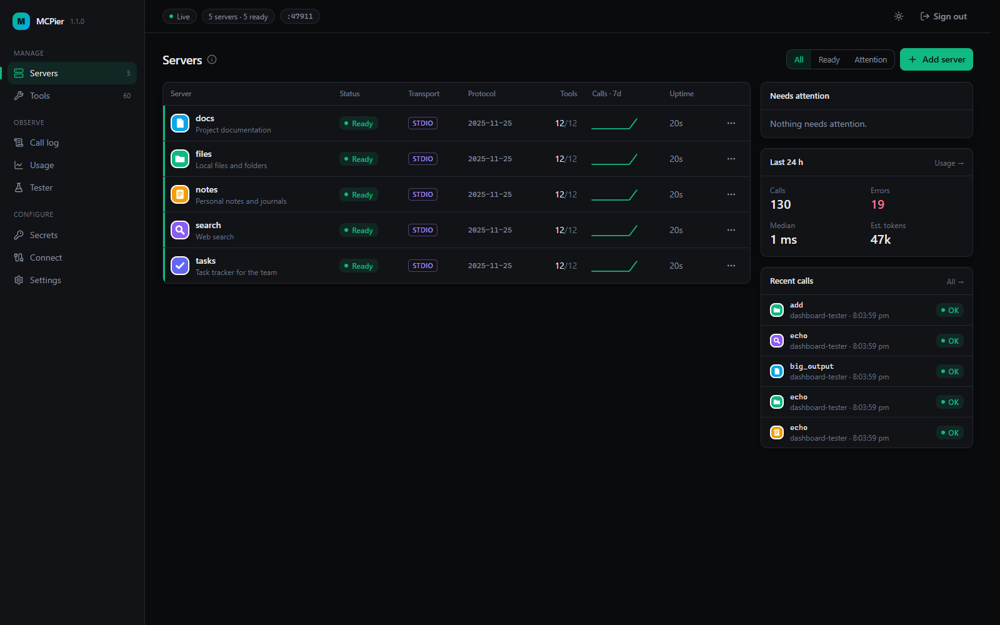

# MCPier

One local MCP gateway for Windows: every client sees a single server, and MCPier runs all of yours behind it.

[](#install)
[](#requirements)
[](https://nodejs.org/)



## Why

Setting up the same MCP servers, secrets and sign-ins in every client is repetitive and easy to get wrong. MCPier does it once: clients connect to one local endpoint, and only the tools they search for reach the model's context.

## Features

- **One endpoint for every client.** Three meta-tools (`search_tools`, `call_tool`, `list_servers`) in front of all your servers, so clients do not load every tool up front.
- **Local and remote servers.** stdio servers and remote Streamable HTTP servers, with OAuth sign-in, configured scopes and automatic token refresh.
- **Secrets stay out of config.** Values live in Windows Credential Manager; config holds `secret:<name>` references.
- **A dashboard.** Servers with their logos, live status and logs; a call log with clean error messages; usage with estimated tokens per server, tool and client; a tool tester; editing as a form or as JSON.
- **A complete CLI.** Add, import, enable, test and remove servers and tools, manage secrets and sign-ins, all from a terminal.
- **Imports existing config.** Paste or import an `mcpServers` block; credential-looking values and OAuth client secrets move into Credential Manager.
- **Runs itself.** Starts on demand or with Windows, and `mcpier doctor` checks the whole setup.

## Requirements

- Windows 10 or later
- [Node.js 24](https://nodejs.org/)
- [pnpm](https://pnpm.io/)
- Git Bash: the commands below are written for it

## Install

From the repository root:

```bash
pnpm install
pnpm build
pnpm add -g "link:$(pwd -W)/apps/cli"
mcpier --version
```

The last command prints `1.1.0`. If `mcpier` is not found, run `pnpm setup` once and open a new terminal.

## Quick start

```bash
mcpier start
mcpier server add files -- npx -y @modelcontextprotocol/server-filesystem "C:\Users\me\Documents"
mcpier server add notion --url <the server's URL> --oauth
mcpier auth login notion
mcpier open
```

`mcpier start` runs the gateway in the background on `http://127.0.0.1:47800/`. `mcpier open` signs your browser in to the dashboard.

## Connect your clients

MCPier prints the setup snippet and where it goes; it never edits a client's config file.

| Client           | Command                         |
| ---------------- | ------------------------------- |
| Claude Desktop   | `mcpier connect claude-desktop` |
| Claude Code      | `mcpier connect claude-code`    |
| Cursor           | `mcpier connect cursor`         |
| VS Code          | `mcpier connect vscode`         |
| Codex            | `mcpier connect codex`          |
| Any other client | `mcpier connect generic`        |

`mcpier connect` with no client lists them. The dashboard's Connect page shows every snippet.

## Common commands

| Command                                                                                               | What it does                                              |
| ----------------------------------------------------------------------------------------------------- | --------------------------------------------------------- |
| `mcpier status`                                                                                       | Whether the gateway runs, with its port and server counts |
| `mcpier stop`                                                                                         | Stop the gateway                                          |
| `mcpier server list`                                                                                  | Servers with status, tool counts and last error           |
| `mcpier server import servers.json --dry-run`                                                         | Preview servers from an `mcpServers` block                |
| `mcpier server add <name> --url <url> --scope <scope> --client-id <id> --client-secret secret:<name>` | Add a remote OAuth server with your own client and scopes |
| `mcpier secret set <name>`                                                                            | Store a secret from a hidden prompt                       |
| `mcpier tools search "<what you want to do>"`                                                         | Search tools the way clients do                           |
| `mcpier auth status`                                                                                  | The sign-in of every OAuth server                         |
| `mcpier autostart enable`                                                                             | Start MCPier hidden when you sign in to Windows           |

Every command has `--help`.

## Security

- **Local only.** The gateway listens on 127.0.0.1, checks the Host and Origin of every request, and the dashboard and admin API need a token that never leaves your machine.
- **Secrets in Credential Manager.** Secret values are never written to config, logs or the call log; they are replaced by their names wherever they could appear.
- **Encrypted OAuth tokens.** Sign-ins are stored encrypted (AES-256-GCM) with a key kept in Credential Manager.

## Troubleshooting

Run `mcpier doctor`: it checks everything that commonly goes wrong and says how to fix it.
